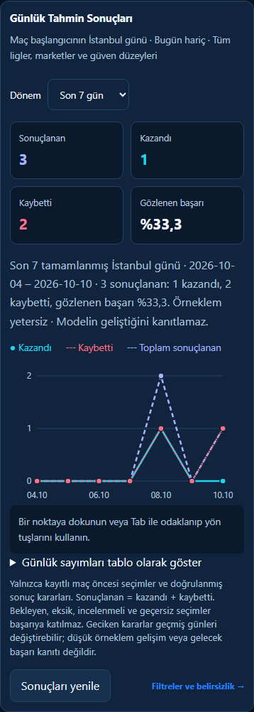
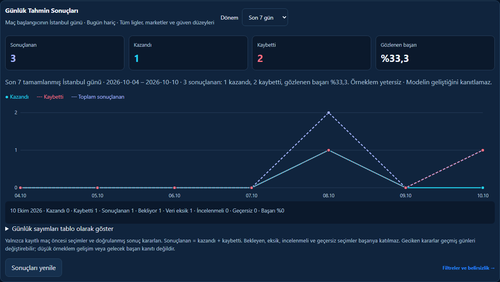
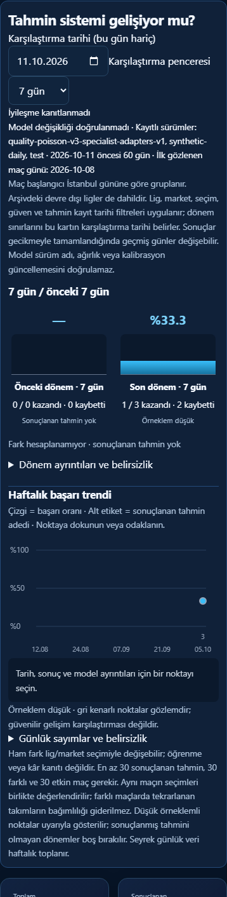
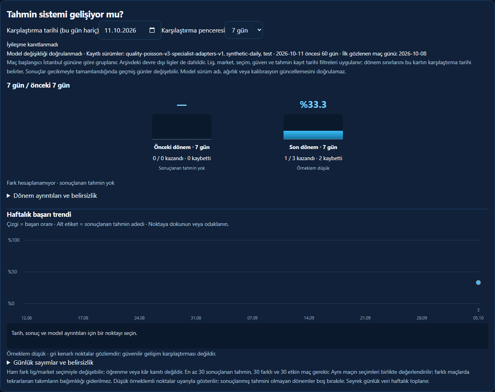

# Issue #125: bounded performance chart and daily results lines

Implements the [issue clarification](https://github.com/donozoyout-ux/Bet-app213/issues/125#issuecomment-6387847486): the homepage uses **three lines**, not bars. Cyan is won, dotted rose is lost, dashed lavender is total settled. Point markers, a text legend and accessible daily table supplement color. Lessons cards are unchanged.

## Behavior and data basis

* The existing Performance chart has an explicit 240px desktop / 200px mobile viewport instead of the conflicting unlimited SVG height. Its coordinate system follows the available width, with readable date labels. Comparison bar tracks are 64px. A no-results/truncated series shows a compact explanation without an empty SVG or axes. Existing uncertainty, sparse-sample and provisional-improvement notices remain.
* Homepage “Günlük Tahmin Sonuçları” defaults to the last **seven completed Europe/Istanbul days**, excluding today, with a 30-day switch. Totals above the plot follow the selected window. Dates use match kickoff day, not capture time or the date a settlement arrived. The window and all-league/market/confidence scope are stated explicitly; the Performance link exposes the existing filters. Delayed decisions can change historical cohorts.
* Both trend graphs share the existing read-only `/api/performance-trends` endpoint and filters. It fetches at most 5,001 snapshots for a bounded 60-day window, then bulk-fetches decisions; there are no new per-day queries, writes, migrations, coupon generation or backfills. The existing PostgreSQL cache remains 30 seconds, under a bumped cache key. Switching 7/30 days reuses the loaded response without another query.
* A counted win/loss requires an immutable persisted prematch snapshot **and** a persisted settlement that passes the existing evidence/current-result reconciliation. Finished scores without a ledger decision are marked awaiting data, never reconstructed wins. Latest revisions are used once; linked picks with the same match/market/selection count once. Captures at/after kickoff are excluded. Pending, missing, disputed and void are separate and excluded from won/lost/settled denominators.
* Successful empty reads show 0 counts and no success percentage. Unavailable data or a truncated scan shows “—” and an explanation, never fabricated zeros or partial totals. Points on an observed zero-result date have no rate in the tooltip. A 15-second request limit, inactive-page abort and retry button handle outages independently of the other homepage panels.
* Tab enters the daily points; left/right arrows, Home and End navigate dates. Enter/Space, pointer hover and touch update the text tooltip with the exact Turkish local date, won/lost/settled, pending, missing, disputed and void; rate appears only with a nonzero denominator. The table provides the same numbers without using the graph. Short histories continue to say “Örneklem yetersiz”; descriptive results do not establish model improvement.

## Verification

All screenshots below use synthetic records in an isolated ASGI/SQLite test database at 100% zoom; no production data is fetched or created. Browser tests use real endpoint responses, not fabricated production chart values.

`tests/test_daily_results_chart.py` covers 390px touch and 1536px desktop: sparse history, empty restart, outage/recovery and scan truncation; three lines/markers, 7/30 days, focus/arrows/Enter/tap/hover, accessible table/summary, live resize, no page horizontal overflow, explicit chart/bar height limits and compact empty states. API tests verify Istanbul midnight boundaries, correction revision deduplication, linked picks, postmatch exclusion, absent-ledger exclusion, pending/disputed/void exclusion, existing exact-market/confidence filters, and two bounded SELECT-only queries. Chart browser requests are GET-only and do not call Telegram/NVIDIA.

Existing performance-trend tests, homepage layout/runtime checks and the full repository CI are also required. Run locally:

```powershell
$env:CHART_SCREENSHOT_DIR='docs/charts-125'
python -m pytest -q tests/test_daily_results_chart.py tests/test_performance_trends.py tests/test_home_reference_browser.py
```

## Homepage, sparse history





## Performance, bounded history graph





## Empty, unavailable and truncated data

Additional screenshots: [mobile empty](home-results-empty-390.png), [desktop empty](home-results-empty-1536.png), [mobile outage](home-results-outage-390.png), [desktop outage](home-results-outage-1536.png), [mobile truncation](home-results-truncated-390.png), [desktop truncation](home-results-truncated-1536.png), [mobile empty Performance](performance-empty-390.png), [desktop empty Performance](performance-empty-1536.png).

No production reset, forced coupon creation, Telegram/NVIDIA send, merge or deployment is performed by this change.
