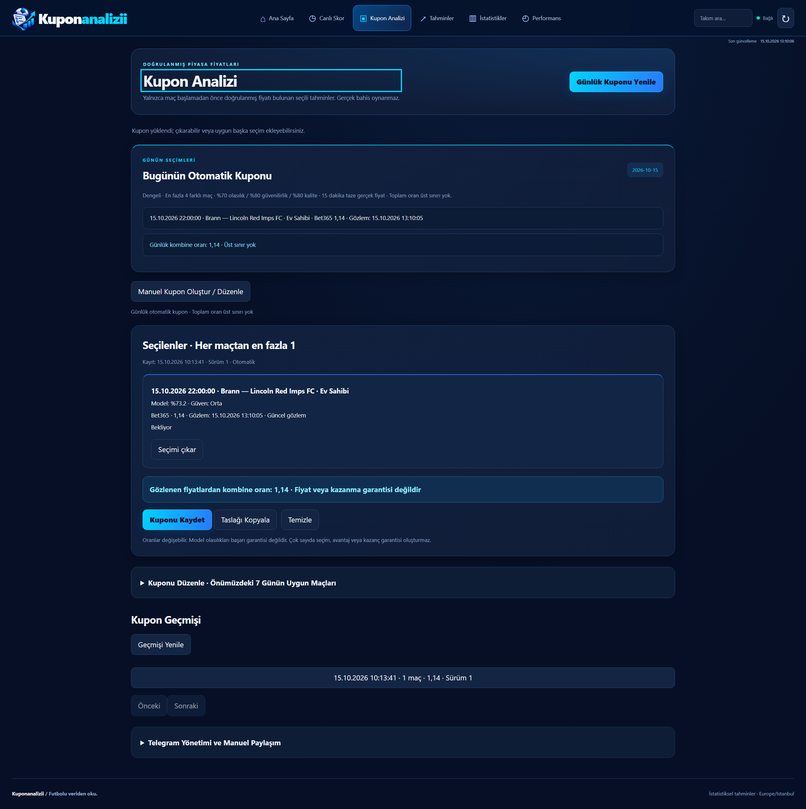
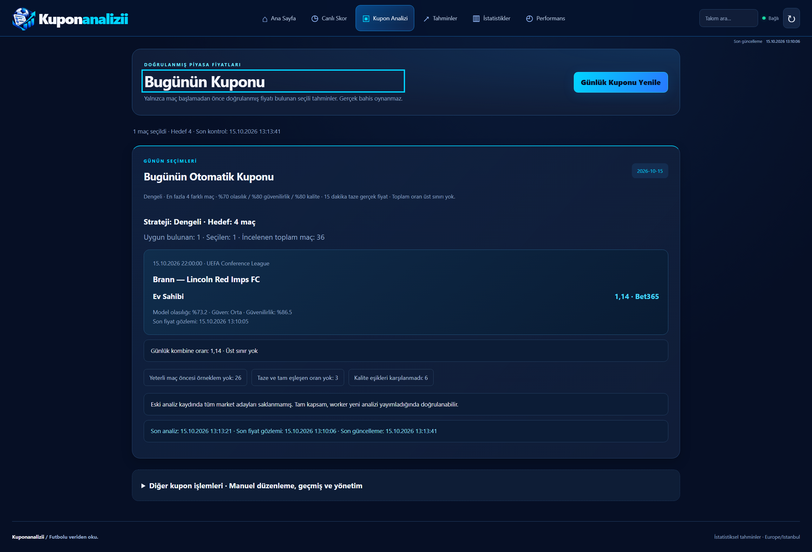

# Günlük kupon incelemesi — 15 Ekim 2026

Salt okunur Render PostgreSQL ölçümü: **2026-10-15 13:13:41 Europe/Istanbul**. Veritabanında toplam 12.904 maç; bu gün için 36 maç, iki aktif Avrupa ligi ve henüz başlamamış 36 maç. Üretimde veri değiştirilmedi, Telegram mesajı gönderilmedi ve deploy yapılmadı.

## Gerçek nedenler ve ölçüm

| Ölçüm | Sonuç |
|---|---:|
| Bugünkü aktif lig maçları / incelenen maçlar | 36 / 36 |
| Güncel cache analizi bulunan maçlar | 36 |
| Gösterim listesinde önerisi bulunan maçlar | 5 |
| Bet365 / Crown / Sbobet fiyatı bulunan maçlar | 36 / 36 / 36 |
| En az bir tam eşleşen, en fazla 900 saniyelik fiyat alanı bulunan maçlar | 5 |
| Üç kaynaktaki fiyat alanları / taze ve tam eşleşen alanlar | 1047 / 56 |
| Kayıtlı adaylarında kupon kalite şartlarını geçen maçlar | 4 |
| Taze ve tam eşleşen fiyatla kupona girebilen maçlar | 1 |
| Örneklem eksikliği / kalite / fiyat nedeniyle elenen maçlar | 26 / 6 / 3 |
| Aynı maçtan alternatif seçim nedeniyle elenen taze adaylar | 0 |
| Eski motor / yeni motor seçimi (aynı dondurulmuş veri) | 1 / 1 |
| Eski / yeni gerçek kombine oran | 1.14 / 1.14 |

‘19 maç elendi’ varsayımı bu ölçümün paydası değil: üretimde bugünün 36 maçı var ve 35'i eleniyor. Aşağıdaki tablo bunların tamamını açıklar. 20 maç/19 eleme durumu ayrıca sentetik regresyon testinde doğrulanır. Tahminler ekranındaki 122 sayısı eski cache'in yedi günlük kapsamına ait; on satırlık tablo veya bir sayfa günlük kuponun paydası değildir.

Eski veri biçimi tüm adayları saklamıyor: çekirdek market adayları ve en fazla iki gösterim önerisi mevcut; diğer marketler için örneklem/erişilebilirlik verisi var. Dolayısıyla 4 kaliteli maç / 26–6–3 ayrımı **kayıtlı adaylar** üzerinden; eksik market olasılıkları yeniden üretilmedi. `candidate_coverage_complete=false` API'de ve arayüzde görünür. Yeni worker yayını bütün sıralanmış adayları saklar; eski cache mevcut son kullanma zamanında yenilenene kadar tam kapsam iddia edilmez. Ham alan sayısı, kupona uygun market sayısı anlamına gelmez.

## Düzeltilen yazılım hataları

- Otomatik motor yalnız `recommendations[:2]` gösterim listesini tarıyordu. Artık tüm aktif liglerdeki bugünün maçları doğrudan SQL ile, LIMIT veya `priced_only` olmadan taranır. Worker'ın tam aday yayını ayrı tutulur; sayfalanan tahmin API'si değişmez.
- Worker'ın öncelikli fiyat güncellemesi yalnız öneri listesindeki maçları görüyordu. Artık listede olmayan bugünkü maçlar da tam maç oranı sorgusu için mevcut kuyruğa girer. Bir checkpoint'te bir endpoint, 8 saniyelik istek bütçesi, başarılı istekten sonra 5 dakika bekleme, boş/hatalı yanıtta kalıcı geri çekilme korunur. Sahadan yeterli geçmiş veri yoksa oran güncellemesi tek başına kaliteli model oluşturamaz.
- Eleme raporu kalite filtresinden sonra hesaplanıyordu ve başarılı tek maçlık cevapta hiç dönmüyordu. Artık her günlük maç için tek bir ana neden, aday kalite/fiyat ayrıntıları ve kaynak kapsamı var. Ana nedenlerin toplamı + uygun maçlar = günlük toplam. Aday düzeyindeki nedenler birbiriyle örtüşebilir; maç sayısı gibi toplanmaz.
- Cache, tarih ve kaynak fiyatı her üretimde yeniden doğrulanır. Gün fingerprint'e açıkça katılır. Kaydetme ve Telegram yeniden doğrulaması da tam aday listesini kullanır; eski sürümler silinmez.

Son analiz: 13:13:21; son kaynak fiyat gözlemi: 13:10:06. Son seçilen fiyat gözlemi: 13:10:05. Daha sonraki canlı yenilemeler ölçümle karıştırılmadı. Yeni worker kodu deploy edilmediği için üretimde ‘sonra daha çok maç oluştu’ iddiası yok.

%70 olasılık / %80 güvenilirlik / %80 kalite, genel model örneklem ve bağımsızlık kontrolleri, tam market/periyot/çizgi eşleşmesi ve 900 saniye sınırı korunur. Kombine oran üst sınırı yok. Telegram 12:00/18:00, en fazla iki otomatik gönderim ve kalıcı idempotency değişmedi.

## Maç bazında açıklama

Çekirdek model örnekleri tarihsel takım ve saha ayrımını gösterir; düşük örneklem yeni veri eklenerek taklit edilmez. Detaylı diğer market örneklem eksikleri ölçüm JSON'unda `sample_gaps` alanındadır.

| DB kimliği | Maç | Ana neden | Kanıt / fiyat alt nedenleri |
|---|---|---|---|
| 11514 | Lech Poznan — Bayer Leverkusen | Örneklem yetersiz | away_sample_size=1, away_venue_sample_size=0, home_sample_size=7, home_venue_sample_size=3, league_sample_size=200 |
| 11515 | Red Bull Salzburg — AC Milan | Örneklem yetersiz | away_sample_size=1, away_venue_sample_size=0, home_sample_size=10, home_venue_sample_size=6, league_sample_size=200 |
| 11516 | Lyon — Crystal Palace | Örneklem yetersiz | away_sample_size=1, away_venue_sample_size=0, home_sample_size=10, home_venue_sample_size=10, league_sample_size=200 |
| 11517 | NK Publikum Celje — Omonia Nicosia FC | Örneklem yetersiz | away_sample_size=5, away_venue_sample_size=2, home_sample_size=7, home_venue_sample_size=3, league_sample_size=200 |
| 11518 | AZ Alkmaar — Hapoel Beer Sheva | Örneklem yetersiz | away_sample_size=3, away_venue_sample_size=1, home_sample_size=10, home_venue_sample_size=6, league_sample_size=200 |
| 11519 | Saint Gilloise — Real Sociedad | Tam eşleşen taze fiyat yok | line_mismatch: 1 |
| 11520 | AC Sparta Prague — Lillestrom | Örneklem yetersiz | away_sample_size=3, away_venue_sample_size=1, home_sample_size=1, home_venue_sample_size=0, league_sample_size=200 |
| 11521 | SCU Torreense — Sunderland A.F.C | Örneklem yetersiz | away_sample_size=1, away_venue_sample_size=0, home_sample_size=1, home_venue_sample_size=0, league_sample_size=200 |
| 12538 | Hajduk Split — AFC Ajax | Kalite eşiği | reliability, score, team_samples, venue_samples, stability, probability |
| 12539 | CSKA Sofia — Monaco | Örneklem yetersiz | away_sample_size=2, away_venue_sample_size=1, home_sample_size=0, home_venue_sample_size=0, league_sample_size=200 |
| 12540 | Egnatia — Midtjylland | Örneklem yetersiz | away_sample_size=4, away_venue_sample_size=2, home_sample_size=6, home_venue_sample_size=3, league_sample_size=200 |
| 12541 | Lugano — Crvena Zvezda | Örneklem yetersiz | away_sample_size=0, away_venue_sample_size=0, home_sample_size=10, home_venue_sample_size=8, league_sample_size=200 |
| 12542 | Panathinaikos — Borac Banja Luka | Tam eşleşen taze fiyat yok | line_mismatch: 3, source_market_unavailable: 3 |
| 12543 | KAA Gent — Aarhus AGF | Örneklem yetersiz | away_sample_size=0, away_venue_sample_size=0, home_sample_size=10, home_venue_sample_size=10, league_sample_size=200 |
| 12544 | KuPs — Trabzonspor | Örneklem yetersiz | away_sample_size=2, away_venue_sample_size=1, home_sample_size=10, home_venue_sample_size=7, league_sample_size=200 |
| 12545 | CS Universitatea Craiova — Getafe | Örneklem yetersiz | away_sample_size=2, away_venue_sample_size=1, home_sample_size=10, home_venue_sample_size=7, league_sample_size=200 |
| 12546 | Riga FC — FC Kairat Almaty | Örneklem yetersiz | away_sample_size=0, away_venue_sample_size=0, home_sample_size=10, home_venue_sample_size=7, league_sample_size=200 |
| 12547 | Mjallby AIF — Inter Club Escaldes | Örneklem yetersiz | away_sample_size=10, away_venue_sample_size=5, home_sample_size=0, home_venue_sample_size=0, league_sample_size=200 |
| 11522 | Jagiellonia Bialystok — FC Ararat Armenia | Örneklem yetersiz | away_sample_size=3, away_venue_sample_size=1, home_sample_size=7, home_venue_sample_size=3, league_sample_size=200 |
| 11523 | Rennes — OFI Crete | Örneklem yetersiz | away_sample_size=3, away_venue_sample_size=1, home_sample_size=1, home_venue_sample_size=0, league_sample_size=200 |
| 11524 | NEC Nijmegen — Levski Sofia | Örneklem yetersiz | away_sample_size=5, away_venue_sample_size=2, home_sample_size=1, home_venue_sample_size=0, league_sample_size=200 |
| 11525 | TSG Hoffenheim — Besiktas JK | Kalite eşiği | reliability, score, venue_samples, probability |
| 11526 | AFC Bournemouth — Sturm Graz | Örneklem yetersiz | away_sample_size=9, away_venue_sample_size=4, home_sample_size=1, home_venue_sample_size=0, league_sample_size=200 |
| 11527 | Dinamo Zagreb — Anderlecht | Kalite eşiği | probability, score |
| 11528 | Ferencvarosi TC — FC Viktoria Plzen | Tam eşleşen taze fiyat yok | source_market_unavailable: 1, line_mismatch: 1 |
| 11529 | Benfica — Celtic FC | Kalite eşiği | reliability, score, team_samples, venue_samples, probability |
| 11530 | Marseille — Olympiakos Piraeus | Örneklem yetersiz | away_sample_size=10, away_venue_sample_size=5, home_sample_size=1, home_venue_sample_size=0, league_sample_size=200 |
| 11531 | Celta Vigo — Juventus | Örneklem yetersiz | away_sample_size=1, away_venue_sample_size=0, home_sample_size=10, home_venue_sample_size=7, league_sample_size=200 |
| 12548 | Sint-Truidense — FC Iberia 1999 Tbilisi | Örneklem yetersiz | away_sample_size=6, away_venue_sample_size=3, home_sample_size=0, home_venue_sample_size=0, league_sample_size=200 |
| 12549 | Heart of Midlothian — Nordsjaelland | Kalite eşiği | reliability, score, team_samples, venue_samples, probability |
| 12550 | FC Twente Enschede — Thun | Örneklem yetersiz | away_sample_size=0, away_venue_sample_size=0, home_sample_size=4, home_venue_sample_size=2, league_sample_size=200 |
| 12551 | Brann — Lincoln Red Imps FC | Uygun | line_mismatch: 1, source_market_unavailable: 3 |
| 12552 | Brighton Hove Albion — Kauno Zalgiris | Örneklem yetersiz | away_sample_size=6, away_venue_sample_size=3, home_sample_size=2, home_venue_sample_size=1, league_sample_size=200 |
| 12553 | SC Freiburg — Baumit Jablonec | Örneklem yetersiz | away_sample_size=6, away_venue_sample_size=3, home_sample_size=2, home_venue_sample_size=1, league_sample_size=200 |
| 12554 | Atalanta — Pafos FC | Örneklem yetersiz | away_sample_size=10, away_venue_sample_size=9, home_sample_size=2, home_venue_sample_size=1, league_sample_size=200 |
| 12555 | FC Copenhagen — Sporting Braga | Kalite eşiği | reliability, score, team_samples, venue_samples, probability |

## Kuponum ve görsel doğrulama

Ana ekranda yalnız günlük otomatik kupon, tarih/hedef/strateji, maç/lig/saat/market, gerçek fiyat ve şirket, model olasılığı/güven, gözlem ve güncelleme zamanları, toplam oran ve doğrulanmış eleme sayıları var. Manuel taslak, geçmiş ve Telegram yönetimi “Diğer kupon işlemleri” içinde erişilebilir; varsayılan açılış bunların isteklerini yapmaz. Kaydedilmiş kuponlar ve tarayıcı taslakları korunur.

Görseller 1920×1080 ve 2560×1440 viewport, %100 zoom ve DPR=1 ile gerçek FastAPI + izole veritabanında alınmıştır. `actual-*` görselleri aynı üretim veri kopyasını kullanır. Önce görselleri master HTML/CSS/JS ile; sonra görselleri yeni kodla çekilmiştir. Üretim kupon geçmişi/gizli yönetim bilgileri dışa aktarılmadığından önce görüntüsünün geçmişi üretim ekranındaki tüm eski kayıtları içermez. Diğer görsellerdeki 20 maç/4 seçim sentetik test verisidir, canlı sonuç değildir. Mobil 390 ve 320 genişlikte günlük ekran ve açılan manuel işlevler yatay taşma olmadan test edilir.

| Önce | Sonra |
|---|---|
|  |  |
|  |  |

## Tekrarlama

`2026-10-15-snapshot.json.gz` yalnız maçlar, takım/lig bağlamı, cache analizi ve fiyat alanı gözlemlerini içerir; bağlantı bilgisi, Telegram ayarları veya kupon geçmişi içermez. Ölçüm JSON'u açılmış snapshot'ın SHA-256 özetini taşır.

```powershell
python scripts/audit_coupon_snapshot.py docs/daily-coupon/2026-10-15-snapshot.json.gz --output scratch/replay.json
python -m pytest tests/test_daily_pool.py tests/test_daily_coupon_browser.py -q
```

Varsayılan tekrar izole SQLite kullanır. `TEST_POSTGRES_URL` yalnız test veritabanını göstermelidir; betik orada geçici şema oluşturur ve sonunda siler. Üretim bağlantısını vermeyin. Playwright görselleri için `--screenshots scratch/capture --label after` eklenebilir. Test sonuçları PR açıklamasında raporlanır.
