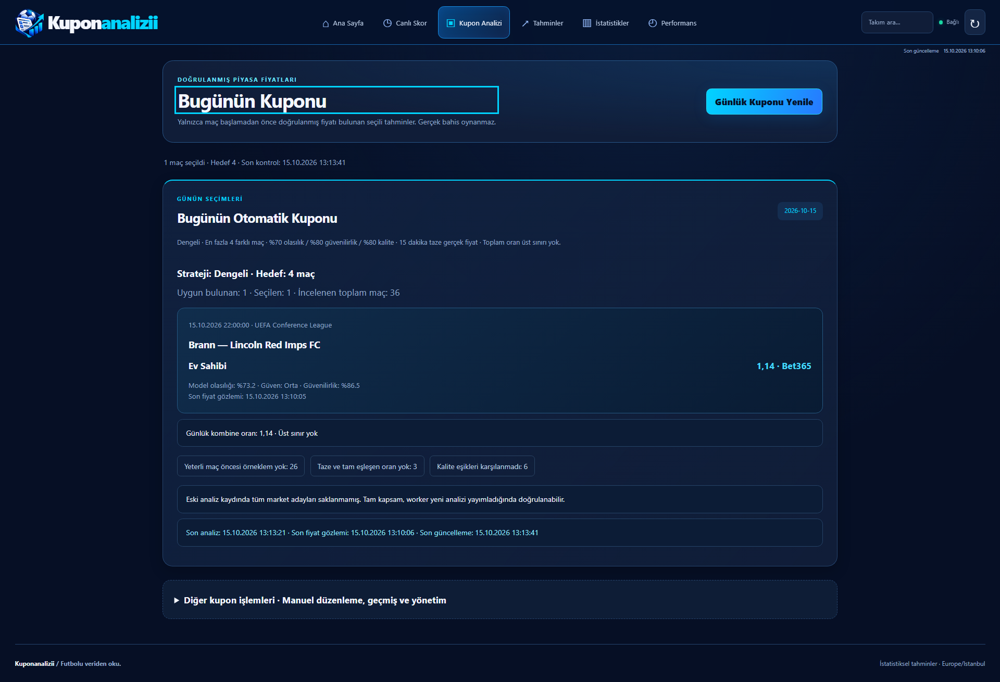
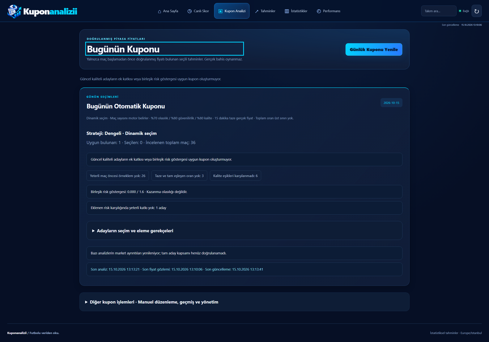

# Dinamik günlük kupon

Bu değişiklik PR #60'ın henüz master'a birleşmemiş kapsam/eleme düzeltmelerini içerir ve sabit dört maç davranışının yerini alır. Yeni PR master'a karşı açılır; PR #60 ayrıca birleştirilmemelidir. Merge veya deploy yapılmadı.

## Seçim politikası

`dynamic-marginal-v1` tüm aktif liglerdeki bugünün maçlarını tarar. Ön elemede mevcut %70 model olasılığı, %80 güvenilirlik, %80 kalite ve modelin genel örneklem kapısı aynen korunur. Gerçek fiyat >1, kaynak Bet365/Crown/Sbobet, gözlenmiş fiyat yaşı en fazla 900 saniye, güncel analiz, tam market/periyot/çizgi eşleşmesi zorunludur. Olasılık ve kalite göstergeleri sonlu ve (0,1] aralığında olmalıdır.

Maç sayısında minimum veya maksimum yoktur. Fiyatın veya kombine oranın üst sınırı yoktur. Her turda kalan adayların mevcut kupona marjinal katkısı karşılaştırılır. Aynı maçtan ikinci seçim ve ortak takımlı farklı maç engellenir; takım kimlikleri güncel veritabanından gelir.

Politika açıkça **kalibre edilmemiş bir risk göstergesi** kullanır. Güvenilirlik/kalite, olasılık gibi sunulmaz; gözlenmiş korelasyon katsayıları veya kupon kazanma yüzdesi üretilmez. Lig ve market yoğunlaşması ölçülmüş korelasyon yerine ihtiyatlı politika cezasıdır. Kesin küresel optimum iddiası yoktur: maliyeti sınırlandırılmış, deterministik ve açıklanabilir açgözlü marjinal seçim uygulanır.

Her aday için:

```text
q = min(güvenilirlik, kalite)
p_adjusted = model_olasılığı × (0.5 + 0.5 × q)
temel_risk = -ln(p_adjusted)
model_değer_göstergesi = q × tanh(ln(model_olasılığı) + ln(gerçek_fiyat))
yoğunlaşma = 0.08 × kupondaki_aynı_lig + 0.04 × kupondaki_aynı_korelasyon_grubu
ek_risk = temel_risk + yoğunlaşma
kalite_seyrelmesi = 0.5 × max(0, mevcut_ortalama_kalite - q)
ek_katkı = model_değer_göstergesi
           - risk_çekincesi × ek_risk × (1 + mevcut_risk / 1.6)
           - kalite_seyrelmesi
```

Risk çekincesi dengelide 0.12, temkinlide 0.20, değer stratejisinde 0.08'dir. Toplam risk göstergesi bütçesi 1.6'dır; bu değer bir oran tavanı veya kaybetme olasılığı değildir. `tanh` uç fiyatların kalite/risk hesabını sınırsız biçimde bastırmasını engeller, fiyatı veya kombine oranı kesmez. Negatif/sıfır katkılı aday eklenmez; yeni risk bütçeyi aşarsa eklenmez. Her tur tüm kalan adayları karşılaştırır; sıra eşitliğinde kimlik sırası kullanılır. Seçilenler ekranda maç saatine göre listelenirken `selection_order` hesaplama sırasını saklar.

## Maliyet ve şeffaflık

Tüm adayların ön kontrolü yapılır; sayfalama veya ilk N maç kesmesi yoktur. Marjinal arama en fazla 100.000 aday değerlendirmesi yapar. Kalan bütçe bir turun tamamına yetmiyorsa tur başlamaz: ilk sayfadaki adaylardan eksik karşılaştırmayla seçim yapılmaz. Mevcut güvenli seçimler korunur; kalanlar `evaluation_budget` nedeni ve `evaluation_budget_exhausted=true` ile açıklanır. Bu, maç sayısı sınırı değildir. API'nin 10 saniyelik toplam süre bütçesi ve worker'ın sınırlı kaynak güncellemesi korunur; HTTP isteği scraper veya model taraması başlatmaz.

`selection_policy` ve `diagnostics.selection` risk/kalite, değerlendirme sayısı, aday kararları ve eleme nedenlerini döndürür. Seçilen her satırda `selection_explanation`: ek risk, ek katkı, kalite öncesi/sonrası ve seçim sırası vardır. Fiyat/kalite kapısından elenen diğer maçlar günlük kapsam raporunda kalır. Varsayılan Kuponum ekranında genel neden adetleri; “Adayların seçim ve eleme gerekçeleri” içinde her maçın ayrıntısı gösterilir. Liste, ilk açılışta gereksiz DOM maliyeti yaratmamak için açılınca oluşturulur.

## API ve kayıtlar

- `POST /api/coupons/automatic?strategy=balanced`: dinamik seçim; `target_matches` üretmez.
- Eski `max_matches` alanı API dokümanından kaldırıldı. Gönderilirse kullanıcı sayısının sessizce uygulanması yerine 422 ve geçiş açıklaması döner. Ana sayfa ve Kuponum bu parametreyi göndermez.
- Uygun portföy yoksa `items=[]` ve neden döner; `SavedCoupon` oluşturulmaz.
- Fingerprint gün/strateji/politika sürümünü ve seçim kalite/fiyat içeriğini kapsar. Aynı ekonomik kupon yeniden kullanıldığında güncel seçim açıklaması canlı yanıtta döner; kaydın tarihsel açıklaması değiştirilmez.
- Eski `target_matches` içeren geçmiş kuponlar silinmez/dönüştürülmez. Manuel kayıt, değişmez sürümler, yerel taslak ve geçmiş erişimi korunur. Veritabanı şema değişikliği yoktur.
- Telegram mevcut `automatic()` çağrısını kullanır. 12:00/18:00, günlük en fazla iki otomatik gönderim, seçim tekrar koruması ve belirsiz yanıtta kör tekrar engeli değişmez. Testlerde yalnız enjekte edilmiş HTTP taşıması kullanılır; gerçek mesaj gönderilmez.

## Gerçek veri kopyası

15 Ekim 2026 13:13:41 Türkiye saatiyle önceki salt okunur PostgreSQL kopyası yeniden kullanılmıştır; yeni canlı üretim ölçümü veya deploy değildir. [Kaynak incelemesi](../daily-coupon/2026-10-15-report.md) ve [dondurulmuş kopya](../daily-coupon/2026-10-15-snapshot.json.gz) önceki sonuçların kanıtıdır.

36 maçın 1'i temel kalite + taze fiyat şartlarını geçiyordu. Önceki motor Brann–Lincoln ev sahibi seçimini 1.14 fiyatla ekliyordu. Model olasılığı yaklaşık 0.732 olduğundan model fiyat çarpımı yaklaşık 0.835'tir. Yeni politikada bu adayın marjinal katkısı negatiftir: **1 seçimden 0 seçime**, yeni kupon kaydı yok. Dört maç veya en az bir maç zorlanmadı. Bu, gerçek kazanma/kaybetme olasılığına ilişkin yeni bir ölçüm değildir. Eski cache tüm market adaylarını saklamadığından tam kapsam sınırlaması arayüzde korunur; kayıp market olasılıkları yeniden üretilmez.

[Ölçümler](measurements.json), 10.000 **sentetik** adaylık maliyet ölçümünü de içerir: 99.955 değerlendirme, 9 seçim, risk göstergesi yaklaşık 1.576, kombine oran 512; bu makinede seçim kısmı 0.2195 saniye. Süre donanıma bağlıdır; canlı veri sonucu veya genel performans garantisi değildir.

| Önce: PR60, sabit hedef | Sonra: dinamik seçim |
|---|---|
|  |  |
|  |  |

Görseller aynı üretim veri kopyasını izole FastAPI/veritabanında, DPR=1 ve %100 yakınlaştırma ile kullanır. Önce görselleri PR60'ın kayıtlı çıktısıdır. Test kuponları daha kaliteli ve farklı takımlı sentetik verilerle ayrıca sınanır; bu veriler canlı sonuca karıştırılmaz.

## Doğrulama

```powershell
python -m pytest tests/test_dynamic_coupon.py tests/test_daily_pool.py tests/test_automatic_telegram.py tests/test_daily_coupon_browser.py -q
python scripts/audit_coupon_snapshot.py docs/daily-coupon/2026-10-15-snapshot.json.gz --output scratch/dynamic-replay.json
```

Testler: dörtten fazla seçim; kalite/yoğunlaşmayla değişen sayı; yalnız olasılık sırasının kullanılmaması; kalite seyrelmesi; ortak takım/aynı maç; taze olmayan fiyat; negatif katkıda boş sonuç; atomik değerlendirme turu; kullanıcı sayısının reddi; geçmiş kayıtlarının korunması ve güncel/audit açıklaması ayrımı. PostgreSQL entegrasyonunda günlük havuz ve gerçek veri kopyasının dinamik sonucu da çalışır. CI sonuçları PR açıklamasındadır.
