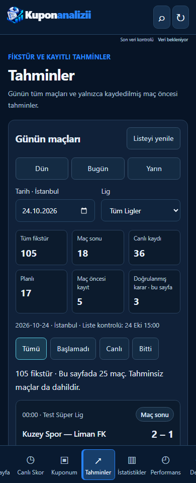
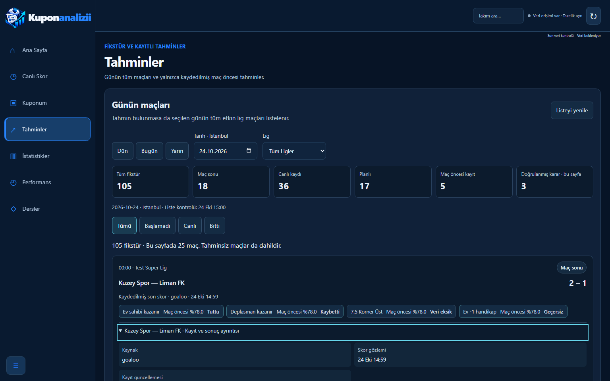
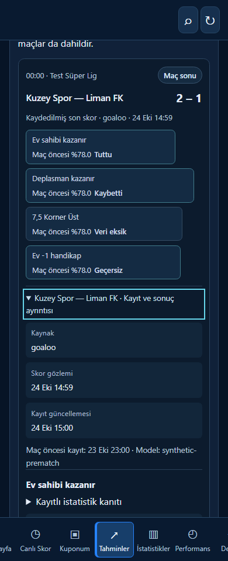
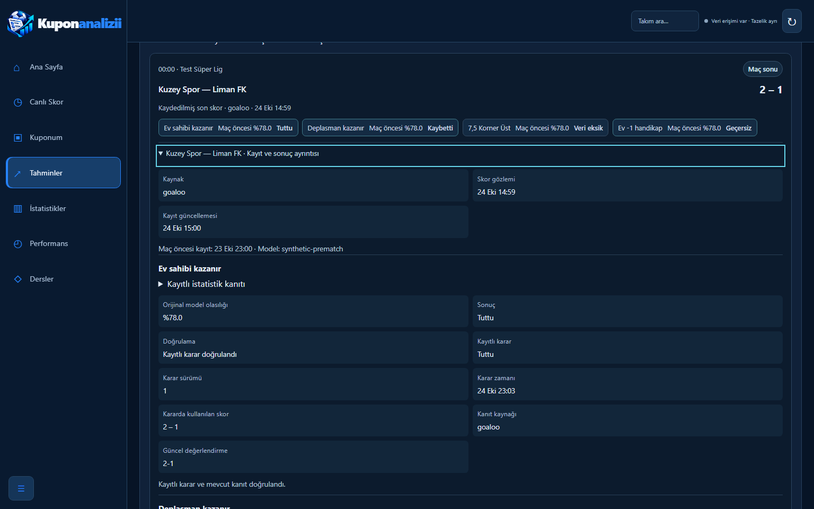

# Issue #128: complete daily fixtures and trustworthy recorded predictions

The Predictions page now starts with the **complete registered fixture catalog** for the selected Europe/Istanbul day, including matches without recommendations, played matches, live matches, scheduled matches and explicit other/unknown states. The existing eight-match recommendation strip remains separately labeled “Önerilen yaklaşan seçimler”; it is not the fixture catalog. Lessons, scraper jobs, model generation, coupon quality/900-second freshness, Telegram delivery idempotency and NVIDIA configuration are unchanged.

## Product behavior

* Today is the server's Istanbul calendar date, including when the device's day differs. Yesterday/Today/Tomorrow, date picker, enabled-league selector and All/Upcoming/Live/Finished controls select the catalog. Historical dates are supported; the upcoming tab uses stored scheduled status, and overdue scheduled rows explicitly say their current state is unknown rather than inventing a live state.
* The catalog shows 25 fixtures/page, with an API maximum of 100/page, SQL LIMIT/OFFSET, stable kickoff/ID ordering and no overall eight/twenty/200-match cutoff. A 225-match day remains fully accessible through pagination. Unknown/postponed/cancelled/abandoned states remain in All. Matches without a known kickoff cannot be assigned to a calendar day and are not guessed into this list.
* The first five counters describe **all registered fixtures for the selected day/league**, independently of the status tab. “Maç öncesi kayıt” counts matches with an eligible nonempty snapshot. “Doğrulanmış karar · bu sayfa” deliberately counts verified selection decisions **on the displayed page**, including verified voids, not all-day wins or a match count. This distinction is visible in the UI. Whole-day evidence is not fetched merely to fill a headline counter.
* Rows show local kickoff, teams, league, stored state and source. Live scores require a nonnegative score pair and a non-future source observation timestamp; 180-second-old live scores become explicitly **last observations**, with current score unknown. Missing/future observation timestamps do not become verified live scores. Recorded final scores without an observation time say the time is unknown. Record update timestamps are separately labeled and never passed off as score observation timestamps.
* Only persisted snapshots captured **strictly before kickoff** are joined. Original selection/probability/model version remain unchanged in live and finished matches. No saved prematch snapshot says “Tahmin oluşturulmadı”; no retrospective model calculation is called. At most 100 pick details/match are projected; overflow is explicitly flagged without deleting source records.
* Latest persisted settlement revision is selected in bulk. The existing evidence-integrity and current-evidence reconciliation determines Tuttu / Kaybetti / Bekliyor / Veri eksik / İncelenmeli / Geçersiz. A score alone, an absent decision, missing statistics or a disputed correction cannot become a verified win. Duplicate linked market/selection picks count once. Expandable keyboard-accessible detail shows original capture/model/probability, recorded decision revision/time, recorded score, source and available statistic evidence; private actor/reason text and raw source payloads are excluded.
* Navy/cyan neutral metadata replaces unsupported confidence emphasis in this view. Win/loss words are shown with explicit proof state; there is no unsupported green “winning” chip. The global header no longer treats `/health` HTTP 200 as a general “connected” guarantee: HTTP liveness, database access and row-level source freshness are separate concepts.
* Current-day polling is one bounded read per 60 seconds, only while Predictions is visible. Other dates use explicit refresh/navigation. Source-expiry/status labels update locally without network calls. A vanished filtered page causes at most one first-page recheck. The whole request has one 15-second deadline, requests are deduplicated/aborted on navigation, stale responses cannot override current filters, and the server clock never moves backward due to cached responses. Unchanged rows preserve open detail/focus. Failed reads clear unverified old scores/counts and show a retry state, not fabricated zeros.

## API and cost bounds

`GET /api/prediction-fixtures?date=2026-10-24&league=1&status=all&limit=25&offset=0` is read-only. Date is optional and defaults server-side to Istanbul Today; status is all/upcoming/live/finished, league is an optional positive internal ID. Selected dates are 1970–2100. The response includes UTC `as_of`, selected local date/timezone, whole-day summary, explicitly page-scoped decision count and pagination. Source freshness is independent of `as_of`.

A miss executes two SELECTs when no eligible snapshots exist, or three with snapshots: day/league aggregate, joined paginated fixtures/snapshots/statistics/teams, then a window-ranked batch of latest settlements for page IDs. No per-match/per-pick database round trips, raw provider payloads, odds scans or historical prediction recomputation are added. PostgreSQL uses one repeatable-read, read-only transaction for a consistent summary/page/evidence view; an isolated CI test verifies writes are rejected. The shared cache has a 15-second TTL, 64-key bound and existing single-flight behavior. Neon pools, plans and background workers are unchanged.

The existing `/api/matches?view=today&date=...` intersection bug is also fixed: an explicit requested day now takes precedence over today's range, so Yesterday/Tomorrow requests do not incorrectly return empty results.

## Verification and screenshots

All images use invented teams and synthetic isolated records. **No live Goaloo match data, odds, production credentials or real Telegram/NVIDIA calls were used.**

`tests/test_daily_fixture_predictions.py` covers empty, 25/105/225-match days and exhaustive pagination, enabled leagues, unknown/postponed states, midnight boundaries, explicit non-today dates, missing/late snapshots, original probabilities, ledger revisions, missing/disputed/void/pending outcomes, unknown/future/stale score timestamps, live-to-finished transitions, actual database-unavailable HTTP 503 despite HTTP 200 liveness, and two/three bounded SELECT-only query contracts. Its PostgreSQL integration checks repeatable-read, read-only enforcement and 225-match pagination in an isolated schema.

Chromium tests at **390px touch / 1536px desktop** exercise date/status navigation, second-page access, keyboard detail, empty/outage/recovery, no horizontal overflow, bounded polling, off-page polling suppression, local expiry despite cached responses and filtered-page shrinkage. Existing homepage, recommendation-strip and match-view tests remain required. Capture:

```powershell
$env:FIXTURE_SCREENSHOT_DIR='docs/fixtures-128'
python -m pytest -q tests/test_daily_fixture_predictions.py tests/test_match_views.py tests/test_minimal_analysis.py tests/test_home_reference_browser.py
```









Other captures: [mobile empty](fixtures-empty-390.png), [desktop empty](fixtures-empty-1536.png), [mobile unavailable](fixtures-outage-390.png), [desktop unavailable](fixtures-outage-1536.png).

No production reset, forced coupon creation, data deletion, plan upgrade, merge or deployment is performed by this change.
