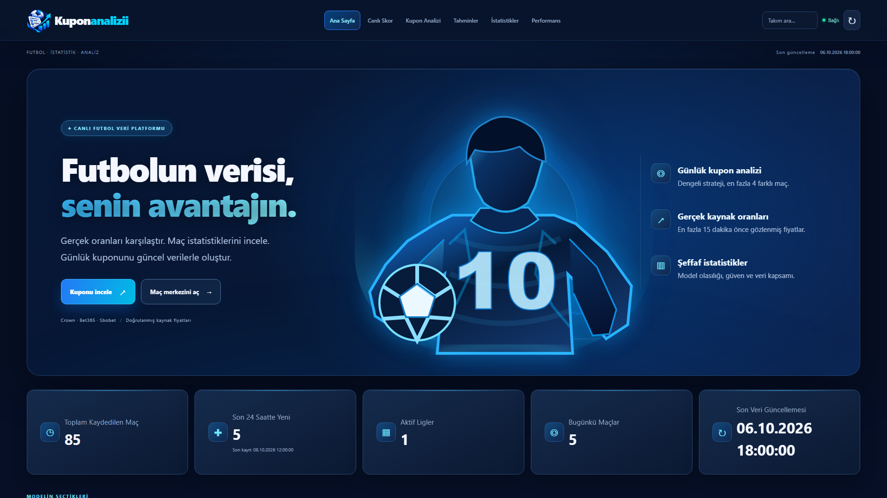
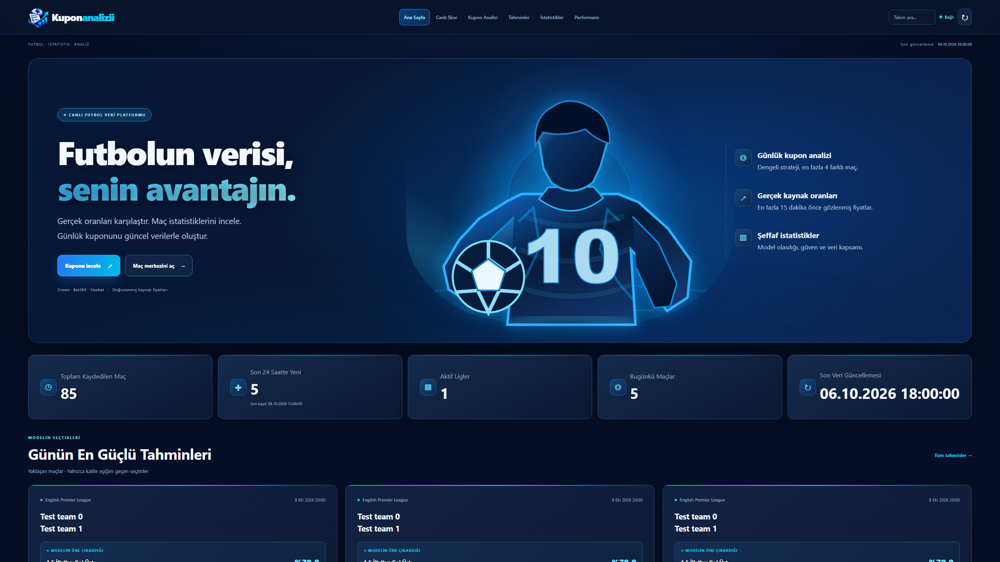
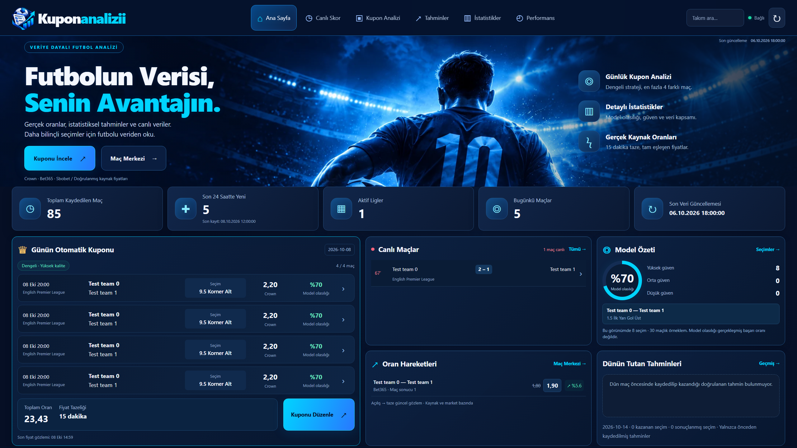

# Referansa dayalı ana sayfa

Başlangıç: master `ec39fa4473` (#58). Feature branch:
`codex/reference-home-dashboard`. Eklerin sıra numarası ile metin çeliştiğinden,
fotoğraf gerçekçiliğinde futbolcu içeren [dashboard görseli](ui-reference/design-reference.png)
tasarım hedefidir. SVG futbolculu görünüm başlangıç durumudur.

## Görsel karşılaştırma

Ölçümler Chromium'da %100 yakınlaştırma (`visualViewport.scale=1`, CSS zoom 1,
deviceScaleFactor 1), aynı dondurulmuş saat ve aynı izole veritabanı fixture'larıyla
alındı. Önceki HTML/CSS/market JS `origin/master` içeriğidir. Her iki görünüm
gerçek FastAPI ASGI uçlarına bağlanır. Ekranlardaki **Test team** maçları ve
rakamları test kayıtlarıdır; üretim verisi veya canlıya deploy sonrası ölçümü
olarak sunulmaz. Ürün kodunda örnek maç/oran verisi bulunmaz.

| Ekran | Önce hero yüksekliği | Sonra hero | Sonra kupon alt kenarı | Sonra gövde / başlık |
|---|---:|---:|---:|---:|
| 1440×900 | 500 px | 296 px | 877 px | 14 / 50 px |
| 1920×1080 | 666 px | 365 px | 1078 px | 17 / 62 px |
| 2560×1440 | 730 px | 485 px | 1433 px | 23 / 83 px |
| 3840×2160 | 730 px | 676 px | 1988 px | 32 / 115 px |

Önce ana sayfada kupon paneli yoktu. Sonra kupon yaklaşık %45 genişlik kaplar;
canlı maçlar / oran hareketleri orta sütunda, model özeti / doğrulanmış sonuçlar
sağ sütundadır. Bu dört masaüstü boyutta dört seçim ve alt kupon kontrolü ilk
ekrana sığar. 1024/768/390/320 px de test edildi; yatay taşma yoktur. Ham
ölçümler: [layout-measurements.json](ui-reference/layout-measurements.json).

1920×1080 önce:



1920×1080 sonra:


2560×1440 önce:



2560×1440 sonra:



Görüntüler referansla açılıp karşılaştırıldı: merkezde büyük futbolcu ve stadyum
ışıkları, soldaki büyük başlık, yatay menü, hero altındaki metrikler ve iki satırlı
üç sütunlu panel grubu korundu. Farklar bilinçlidir: beş gerçek sistem metriği
var; Premium/Hesabım, kazanç grafiği ve AI başarı yüzdesi yok. Model halkası yalnız
belirtilen seçimin model olasılığıdır. Kaynakta canlı maç veya fiyat hareketi
yoksa gerçek boş durum gösterilir; paneli doldurmak için maç/çizgi üretilmez.

## Uygulama sınırları

- `dashboard-home.js` mevcut otomatik kupon, canlı maç ve yaklaşan oran API'lerini
  kullanır. Model özeti ana sayfanın mevcut priced-only cevabını paylaşır; yeni
  ağır istatistik veya performans sorgusu eklenmez. Dün sonuçları mevcut akıştan
  gelir. Panel düğmeleri mevcut maç analizi ve kupon düzenleyicisini açar.
- Kupon .70/.80/.80 kalite, 900 saniye gözlem ve farklı maç şartlarını korur.
  Toplam oran üst sınırı yoktur. Süresi dolunca kupon toplamı temizlenir.
  Oran hareketleri kaynak + market + aynı line için açılış ve taze gözlemi
  karşılaştırır; ara noktalar veya sparkline uydurulmaz.
- CSS tek token kümesine, bir ana sayfa grid'ine ve merkezi responsive bloklara
  toplandı. Önceki SVG/hero/yeşil tema ve geniş ekran override katmanları alınmadı.
  Kullanılmayan eski SVG URL'si geriye uyumluluk için servis edilmeye devam eder.
- FastAPI iş kuralları, veri şeması, scraper/worker, Telegram gönderimi ve
  12:00/18:00 programı, Actions ve Render ayarları değişmedi. Üretim işlemi veya
  gerçek Telegram mesajı yoktur. Ana sayfa otomatik kupon API'sini çağırır;
  gönderim API'sini çağırmaz.

## Hero asset ve üretim kaydı

Yerel asset: `src/api/assets/kuponanalizii-stadium.webp` (2172×724, 135812 bayt).
Kullanıcının verdiği fotoğraf görünümündeki referans, yerleşik **imagegen** aracıyla
arayüz/yazılardan arındırılarak yeniden oluşturuldu. Gerçek bir sporcunun fotoğrafı
olduğu iddia edilmez. PNG pikselleri boyutlandırma/kırpma yapılmadan WebP olarak
kodlandı. Harici görsel servisi veya yeni runtime bağımlılığı yoktur.

Kullanılan prompt:

> Edit the provided dashboard reference into a production website HERO BACKGROUND
> ASSET ONLY. Extract/reconstruct the photographic blue football stadium and
> central male football player viewed from behind holding a football at his left
> hip, dark royal blue jersey with number 10, photorealistic fabric, realistic
> anatomy, black hair, bright electric blue stadium floodlights, cinematic cyan
> rim lighting. Retain the reference subject and its photographic quality and
> saturated midnight-navy/cyan sports atmosphere. Remove ALL UI panels, logos,
> typography, letters, handwriting, charts, badges, buttons, menus, metrics,
> arrows, and text, apart from the number 10 on the jersey. Do NOT render a
> dashboard or screenshot. Output one seamless wide panoramic 3:1 banner, ideally
> 2400x800 or comparable high resolution. Put the player's entire head, back and
> football in the central 45%-72% of the composition, cropped at hips at bottom as
> in reference. Leftmost 40% should be very dark navy stadium ambience with
> subdued detail so white heading can be overlaid by real HTML. Rightmost 25%
> should be dark navy stadium seating and lights so feature labels can be
> overlaid. No border or rounded corners. No SVG/vector/cartoon look. This is a
> local background asset for the user's existing website.

## Test tekrarı

```sh
python -m pytest -q -rP
node tests/home_runtime.cjs
node tests/dashboard_runtime.cjs
node tests/predictions_runtime.cjs
node tests/market_runtime.cjs
node tests/coupon_runtime.cjs
```

`HOME_SCREENSHOT_DIR` ile yeni testin PNG/JSON çıktıları alınabilir.
`HOME_CAPTURE_LABEL=before` yalnız görsel karşılaştırma için master'ın statik
dosyalarını kullanır; ürün davranışını veya API'yi değiştirmez. Varsayılan test
yeni tasarımı ve gerçek kupon/maç etkileşimlerini doğrular.
