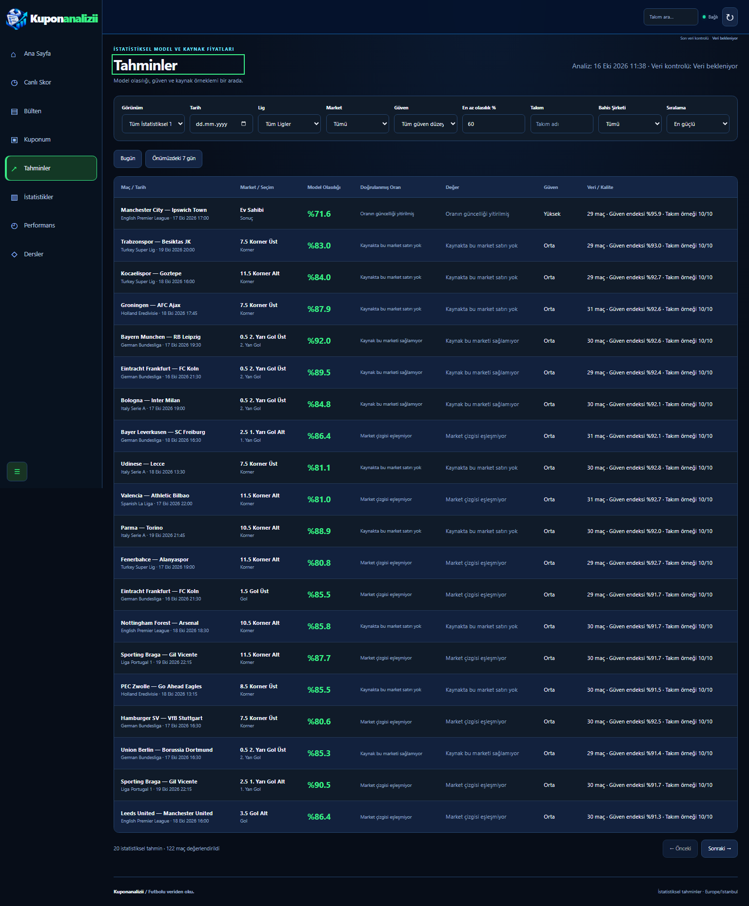
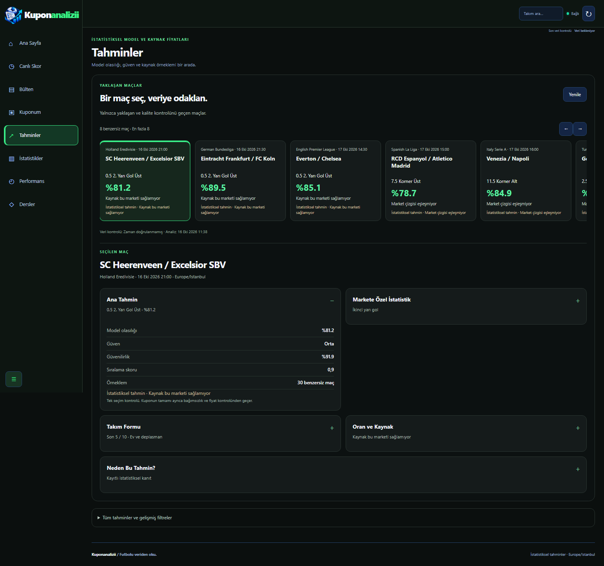
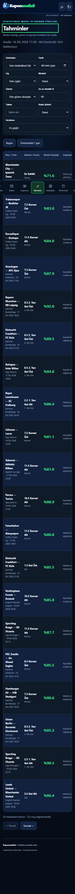
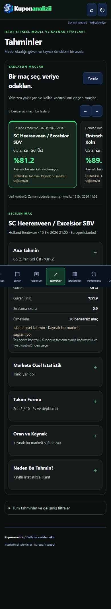

# Minimal match analysis

PR #70 was open and unmerged when development began. This work starts at its head `16d74ba785552ccbba1ce2f243ace3d06cc60049`, on `codex/minimal-match-analysis`. The separate PR targets `codex/sidebar-predictions-refresh`, so its diff contains only this follow-up. PR #70 is unchanged.

## Experience

The predictions page opens with up to eight distinct, upcoming fixtures. Each card uses the highest existing recommendation score, then reliability/probability as tie breakers, among the already-qualified published recommendations. No candidates are invented, and the list is never padded by lowering quality thresholds. Scrolling reveals the remaining cards in this bounded strip; it does not silently append more than eight.

One selected match appears below. The first eligible fixture is selected on entry. Main prediction, market evidence, team form and price/source panels have concise summaries; their native keyboard-accessible disclosures keep only one expanded panel at a time. The optional explanation uses recorded numeric evidence only. The existing full board and all its filters are retained in a closed secondary disclosure. Existing match dialogs on other screens remain available.

The existing sidebar remains fixed and collapsible. The match workspace uses charcoal surfaces and green accents; mobile panels use a single column, with a touch-scrollable match strip and the existing accessible navigation.

## Existing data contracts

- `GET /api/predictions?limit=8`: published, qualified recommendations and board generation/expiry metadata.
- `GET /api/matches/{id}/statistics`: selected match, market-specific observations, form, model evidence and verified bookmaker prices.
- `POST /api/coupon/quote`: **existing read-only** validation for the strip's distinct selections. The UI does not recreate coupon quality thresholds, save a coupon, settle it or send it anywhere. Each returned quote is bound to match ID, recommendation ID and bookmaker. Passing this check does not promise positive expected value or whole-coupon independence.
- The only added server route serves the JavaScript asset. No model, query, database schema, collector or new data API was added.

Requests have cancellation, identity and generation guards. Changing the selected match immediately clears its previous details. Completed, started or rescheduled fixtures returned by the detail API are removed. Board expiry, quote expiry and detail expiry are enforced while the page stays open. Out-of-order responses cannot replace the current match. A reload drops a legacy prediction match query and selects again from the freshly validated strip. Hidden-tab return rechecks data.

## Source limitations

- The list reflects the database/provider's `scheduled` status and kickoff; this UI does not independently certify real-world fixture correctness.
- A fresh statistical board does not imply a fresh price. Every displayed price retains its own observation and expiry. The existing 900-second backend rule is unchanged. Historical/stale prices are explicitly identified; a missing or mismatched price is never substituted from another line, market, period or bookmaker.
- The currently deployed API used for the images does not supply `cache.checked_at`. The page therefore displays an unverified control time, rather than relabeling model generation as a successful check. PR #70 adds that metadata when deployed. Generation and price evidence times remain separate.
- Corner/card API windows provide observed aggregates and sample counts, not individual historical corner/card rows or each row's evidence time. The panel labels these as averages from recorded observations. Unknown red-card values are never zero. If the exact selected line/direction has no observed rate, it explicitly says so; no under-rate is inferred from an over-rate.
- Goal history only displays rates actually supplied for that line. Asian-handicap line-specific realized history is not supplied by this API. First-/second-half panels use only the corresponding half's verified aggregates.
- Form rows show recorded result dates and the Goaloo-backed source. Individual result observation timestamps are not supplied. UEFA domestic context is separately labeled and never added to cup probabilities or confidence.
- Negative expected value is marked as **not an advantageous bet**, including when the existing coupon validator accepts the quality/price of that single selection.
- Failed or insufficient evidence shows an explicit empty/error state. No NVIDIA dependency, remote AI call or generated narrative is introduced.

## Real-data visual evidence

Images use actual deployed API responses recorded during the capture, not seeded match names, synthetic odds or demo sample sizes. [Capture evidence](capture-evidence.json) records fixture IDs, timestamps, request methods, response status and width checks. Only GETs and the existing read-only coupon quote POST were allowed; provider/Telegram/NVIDIA/scraper actions were not requested. These snapshots illustrate the observation time, not continuing availability.

| Before (1536px) | After (1536px) |
| --- | --- |
|  |  |

| Before (390px) | After (390px) |
| --- | --- |
|  |  |

[320px](after-320.png) · [768px](after-768.png) · [1024px](after-1024.png) · [Desktop sources](sources-1536.png) · [Mobile sources](sources-390.png)

Reproduce explicitly: set `CAPTURE_MINIMAL_ANALYSIS=1` and run `python -m pytest tests/test_minimal_capture.py`. It is opt-in and skipped in normal CI, which never contacts the production app for screenshots. Isolated browser/unit fixtures used by ordinary tests are not injected into the application or used as live display fallbacks.

## Validation

The PR description contains final commit/CI results. New Chromium coverage exercises all five required widths; 0, 1, 4 and 8 matches; unique IDs; initial selection; switching cards; mutually exclusive disclosures; scrolling; delayed responses; stale boards; missing statistics/prices; negative value; and a match that becomes finished. Market cases cover available goal, card, corner, result and specialist candidates; unavailable categories abstain without weakening quality rules. JavaScript degraded/race scenarios run independently under Node.

Existing coupon, learning, Telegram, collector and PostgreSQL tests remain in the full CI suite. No master merge, Render deploy, real NVIDIA request or Telegram message was initiated.
