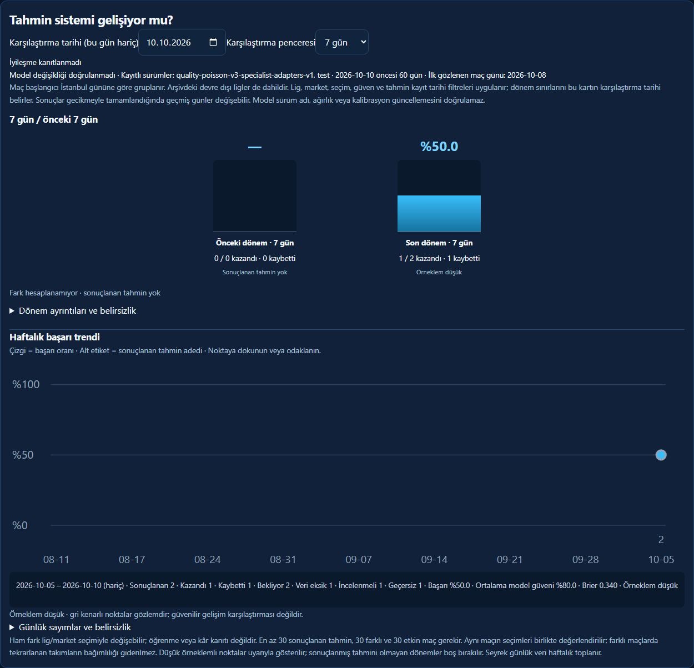
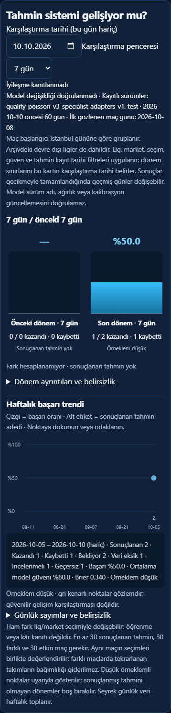

# Performance charts

The comparison chart shows recorded prematch success for the previous and most recent 7 or 30 days. The signed percentage-point difference is descriptive; the existing improvement and model-update safeguards are unchanged.

Sparse daily data uses Monday-based calendar weeks clipped to the 60-day kickoff window. Weekly rates, confidence averages and Brier scores are recomputed from underlying eligible records, never averaged from daily percentages. Daily mode requires at least 14 active days and at least five decided predictions on 70% of active days. Low samples remain visible with a warning; only undecided buckets have no rate. Truncated queries remain explicitly flagged and do not draw trend points.

League, market, exact selection, confidence and Istanbul capture-date filters apply before aggregation. The comparison anchor still defines kickoff cohorts and excludes the anchor day. The endpoint remains bounded to 5,000 snapshots with two bulk reads and no per-point queries.

Screenshots below use synthetic test fixtures through the real API, not production predictions. The sparse fixture contains one won, one lost, two pending, one missing-data, one disputed and one void record. Screenshot-only CSS hides fixed navigation so it does not overlay the full panel capture.

Validation: performance aggregation and browser tests, existing success-rate/status tests, JavaScript runtime checks, and the repository CI suite.
