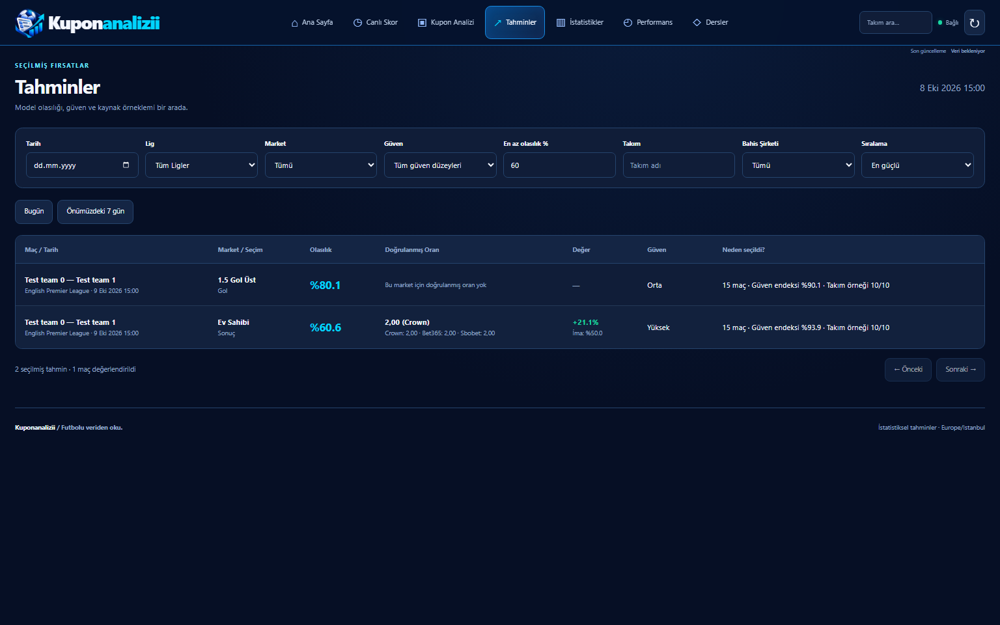
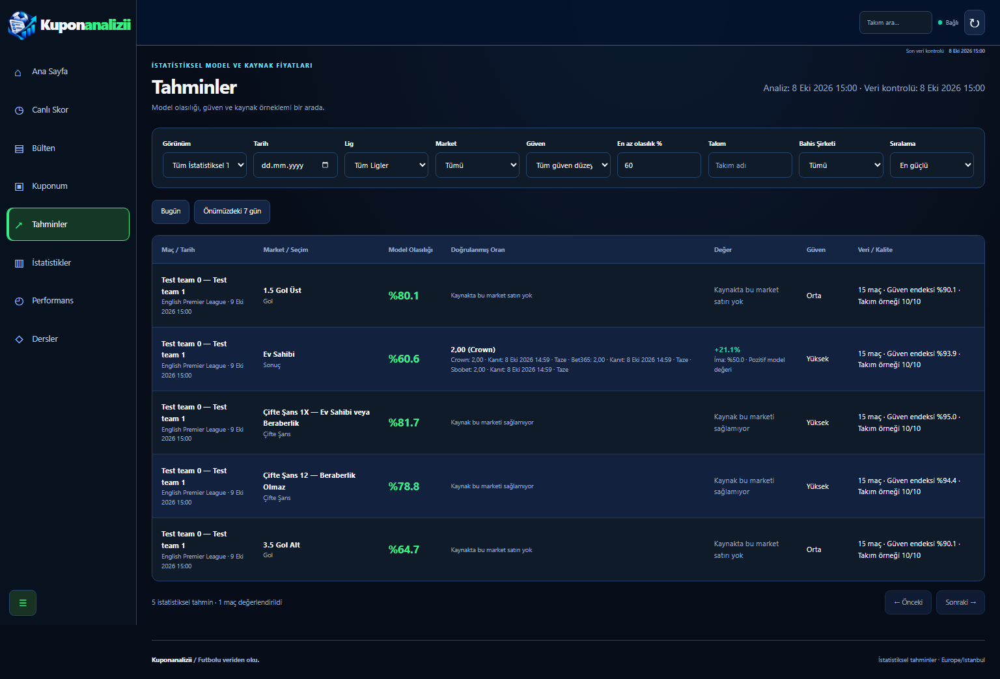

# Sidebar and prediction refresh review

Base: `origin/master` at `7e9d96f`. Branch: `codex/sidebar-predictions-refresh`.

## Behavior

- Desktop navigation is a collapsible left sidebar from 768px. The browser stores only its collapsed preference. Mobile navigation scrolls horizontally, brings the active destination into view, and retains all destinations, including the bulletin (the existing upcoming match view).
- Home accepts only scheduled fixtures with future kickoff times. The existing database eligibility check remains authoritative. Browser expiry removes started fixtures without waiting for polling; delayed responses cannot move its effective clock backwards or restore expired fixtures. Returning to a visible tab and crossing an Istanbul calendar day refresh the page.
- Analysis generation, database check and price evidence times are separate. Expired boards are explicitly identified, and home stops presenting an expired board while waiting for a successful refresh. Failed checks display an error rather than a new success time.
- The statistical view reads worker-published candidates, including alternatives outside the two selected recommendations. It does not run models in HTTP, invent missing candidates, or change selection thresholds. Existing recommendation API defaults remain unchanged.
- The verified-price view filters before pagination. `total` reflects all filters. Selected-bookmaker price/value presentation uses that bookmaker rather than silently substituting the best competitor price. Expiring verified quotes leave the verified view.
- Probability, source price and model expected value have separate columns. Missing prices retain reason codes translated for the user. Crown/Bet365/Sbobet observations include their evidence times. Negative value explicitly says it is not an advantageous bet. A verified quote is not a promise that coupon quality/independence rules are satisfied.

## Live read-only investigation — 16 October 2026

Render workspace `tea-db1u8a8m7kps73csvh70`, database `dpg-db39f66k1f9s738tgug0-a`. Queries ran through Render's read-only SQL tool. Match checks at 07:43:21 and 07:49:57 UTC (10:43:21 and 10:49:57 Istanbul); API observations were collected between these checks. Collection continued independently, so freshness can change between observations.

Evidence: [SQL match result](live-match-evidence.json), [raw schedule evidence](live-schedule-evidence.json), [bounded API observations](live-observations.json).

| Fixture | Stored future record | Separate historical records |
| --- | --- | --- |
| Manchester City–Ipswich | ID 824, provider 3003915, scheduled, 17 October 2026 14:00 UTC | ID 14, provider 2590914, finished, 24 August 2024 |
| Bayern–Leipzig | ID 4084, provider 3018832, scheduled, 17 October 2026 16:30 UTC | IDs 3547 and 3727, finished, December 2024 / August 2025 |

The raw future schedule strings are `2026-10-17 22:00` and `2026-10-18 00:30` with stored source timezone UTC+08:00. Their normalized kickoff times agree with those strings. These observations establish what the provider snapshot and database contain; they do not independently establish that the real-world schedule is correct. Team names alone cannot identify an old fixture: external ID, status and kickoff must all be checked. This PR does not rewrite schedules.

### Concrete missing-price causes

- City: selected **7.5 corners over** has `line_mismatch`. SQL contains only Bet365 **10.5** full-time corners, price 1.90, field evidence 07:23:59 UTC. Even the exact 10.5 candidate is `odds_stale` in the captured API observation. A 10.5 quote cannot price a 7.5 selection.
- City: totals source line is **3.5** for Crown/Bet365/Sbobet. The 1.5 and 2.5 model alternatives are `line_mismatch`; 3.5 has a source quote. First-half source line is 1.5 and cannot replace full-time totals.
- Bayern: full-time totals source line is **4.5**; captured 1.5/2.5/3.5 model alternatives are `line_mismatch`. Corners source line is **10.5**, Bet365 1.95, field evidence 07:14:39 UTC; exact candidates are stale, other lines mismatch.
- Bayern's selected **0.5 second-half goals over** is `source_market_unavailable`. First-half line 2.0 is not a replacement.
- City home model probability 0.716398 with actual best quote 1.24 has expected value **−0.1117**. Bayern home probability 0.777022 with quote 1.24 has **−0.0365**, and that captured quote is stale. Neither is an advantageous bet merely because model probability is high.
- The SQL observations contain per-field `_field_observed_at` evidence. `updated_at` and `last_scraped_at` are not substitutes for a quote's evidence time.

### API comparison

- `GET /api/predictions?limit=20`: 200; 20 grouped fixture records; snapshot freshness and generation metadata present. This is the existing recommendation view. Home additionally uses `priced_only=true` and existing coupon qualification.
- `GET /api/predictions/best?limit=100`: 200; 100 flattened recommendation rows, bounded by the requested limit. Two chosen recommendations may omit a lower-ranked candidate with an exact source line. The new optional `statistical_all=true` view exposes stored alternatives without altering coupon selection.
- `GET /api/matches/824/statistics` and `/4084/statistics`: 200; candidate reasons establish the line/source/staleness differences above.
- `GET /api/odds-coverage`: 200; independently reports source rows, rejection counts, freshness, daily qualification and the unchanged 900-second maximum age.
- `GET /api/coupons?limit=2`: 200; two saved automatic coupon history rows from 15 October, both combined odds 1.14. Saved history is not a live quote. This investigation did **not** call automatic/save/edit/settle endpoints: `/api/coupons/automatic` writes saved coupons. The local tests exercise those behaviors against isolated test databases instead.

### Separate source-repair stage proposed

If broader priced coverage is required, add supported alternate source lines in a separate PR: verify provider match/market/period/line/bookmaker identities and field-specific evidence; retain captured parser fixtures; test stale/future timestamps, changed lines and absent fields; then roll out the collector change independently. Check real fixture provenance before any schedule correction. Never infer an alternate-line price or refresh old evidence solely because another source field was collected. No source repair, database mutation or provider collection was initiated here.

## Review screenshots

These are Chromium renders with explicitly isolated test records, not claims about live fixtures or live odds. Baseline files are read from `origin/master`; after renders use the branch. Width checks assert no document-level horizontal overflow. The table and mobile navigation intentionally have their own horizontal scroll areas.

| Before, 1536px | After, 1536px |
| --- | --- |
|  |  |

[320px](after-320.png) · [390px](after-390.png) · [768px](after-768.png) · [1024px](after-1024.png)

Regenerate explicitly with `CAPTURE_REVIEW_SCREENSHOTS=1 python -m pytest tests/test_sidebar_refresh.py::test_capture_review_screenshots`.

## Validation

See the PR description for final test and CI results. New regression tests cover independent statistical candidates, pagination, current database status, delayed stale responses, kickoff expiry, live day rollover, sidebar persistence, negative value, evidence display and quote expiry. Browser navigation coverage uses 320, 390, 768, 1024 and 1536px, includes every destination and all ten analysis tabs. Existing coupon tests cover manual editing and independence.

The 900-second quote rule, model/coupon quality thresholds, coupon independence, Telegram schedule, NVIDIA and learning engine are unchanged. No master merge, Render deploy, Telegram send or NVIDIA request was initiated.
