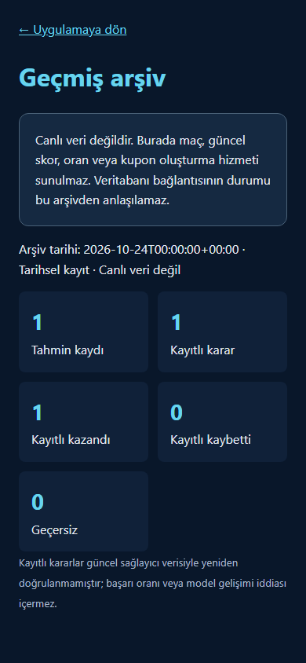

# Issue 119: durable storage and encrypted audit snapshots

Status: **staged infrastructure, not a production migration**. No deploy, provisioning, real-data export, Telegram or NVIDIA request was performed. Refs #119; this PR does not close it.

## Verified recovery state (24 October 2026)

With the user's confirmation, read-only Render inspection in Deniz's workspace showed `betappv33333` as `unavailable`, `not_suspended`. A read-only connection attempt returned `service temporarily unavailable`. The older `betappv33` is still suspended. We did not resume, reset, delete or replace either database. No fresh production backup is claimed. Preserve both until recovery has been verified by a full native backup and isolated restoration.

Render's current documentation confirms that persistent disks require a paid service; free service filesystems are ephemeral. Therefore production SQLite on free Render would silently lose data. This PR deliberately keeps that unsafe path rejected. Reference checked: https://render.com/docs/disks . No paid resources are enabled.

## Data inventory and boundaries

| Tables | Classification | Exported here |
| --- | --- | --- |
| leagues, seasons, teams, matches, bookmakers, referees | Third-party/source identity and fixture data | No; only internal match references accompany forecasts |
| match_statistics, match_events, odds_1x2, asian_handicap, asian_totals, odds_snapshots, market_odds | Provider observations, prices and raw payloads | Never |
| prediction_snapshots | Original app predictions with embedded provider fields | Pick index, enumerated market/selection, finite model probability, capture time and model-name digest only; labels, raw and verified odds excluded |
| prediction_settlements | App decisions with provider evidence | Revision, outcome, timestamps and internal identity only; actual scores, evidence, reason and actor excluded |
| saved_coupons | Private ownership and embedded source prices | UUID, revision, created time only; no payload, root/owner identifiers or prices |
| learning_reports | App analytics with source manifest | Report ID, created time and method-name digest only; no source manifest or free-text summary |
| learning_slices, learning_lessons, learning_heads, learning_ai_explanations | Derived analytic structures/free text | Not in v1; require separate field-by-field rights/privacy approval |
| telegram_deliveries | Delivery/dedup ledger and message identifiers | Never; must remain in transactional storage |
| scraper_jobs, scraper_job_items, scraper_issues, collector_retries | Operational queue and potentially source/error content | Never |
| prediction_boards, board_editions, board_heads, daily_coupon_publications, published_match_analyses, board_read_publications | Replaceable or historical publications containing provider content | Never |
| learning_ai_tasks, learning_ai_quotas, learning_ai_gates | Operational provider queue/quota | Never |
| Users, credentials | No user table found in current models; browser owner hashes live in coupons; credentials in environment | Never |

This is an **allowlisted audit projection, not a full database backup**. It cannot reconstruct live coupons, foreign-key matches/leagues, provider evidence, Telegram dedup, or original learning narratives. It must not be used to hydrate live tables or resume automated deliveries. Archived outcome decisions are historical, not reconciled against current scores; the fallback therefore does not calculate a current success rate.

The old private archive PR #6 is not enabled, merged or depended on. Its key-substring filtering is replaced here by explicit fields/types and enum/number validation. Do not run the old workflow until it is separately hardened or superseded. No unverified third-party dataset may be uploaded, even to a private repository. `ARCHIVE_RIGHTS_REFERENCE=APP-<number>` refers to an operator-maintained, reviewed rights record for these exact outputs; a syntactically valid reference is not itself evidence of rights.

## Configuration and storage semantics

- Default `STORAGE_BACKEND=postgresql` preserves current live operation and multi-process PostgreSQL locking. An external managed PostgreSQL service can use the existing asyncpg URL without coupling to Render Postgres. No external service has been chosen, provisioned or paid for.
- `STORAGE_BACKEND=archive` explicitly ignores DATABASE_URL without modifying it, never initializes a replacement database, and never starts the scraping worker. Live APIs keep returning 503. `/health` is HTTP process liveness, not live-data readiness.
- `/archive` is a separate read-only historical view. `/api/archive-summary` works independently of the live database and requires `ARCHIVE_FILE`, `ARCHIVE_ENCRYPTION_KEY` and explicit `ARCHIVE_PUBLIC_SUMMARY_APPROVED=true`. No private individual records, match IDs, coupon IDs, credentials or arbitrary text are returned. Tampered/missing files fail closed; timestamps and stale status are shown. Live endpoints never silently substitute archive results. The archive is optional; its absence must not prevent HTTP boot.
- The read-only mode has no writer concurrency to arbitrate. It must not resume pending jobs or Telegram deliveries. Multiple processes can read the sealed file; updates must be atomically published by an operator after validation. PostgreSQL live mode retains advisory locks and unique constraints. A future SQLite live adapter must hold one OS-level writer/process lease, use WAL/busy timeout and serializable transactions, implement currently PostgreSQL-only odds operations, and prove process-crash/dedup behavior before production is permitted.

## Export, private Releases and isolated restore

1. Recover source connectivity first. Keep a full native database backup off GitHub if legally permitted; test it in an isolated environment before any migration. This audit snapshot is additional protection, not disaster recovery for operational tables.
2. Review rights and privacy for the v1 projection. Create a dedicated SELECT-only source principal with only SELECT on prediction_snapshots, prediction_settlements, saved_coupons, learning_reports, and matches (only id/kickoff_at are read). The exporter rejects superusers/role creators/database creators and principals with source-table write privileges. Source reads run in a server-enforced read-only repeatable-read transaction. It never calls application initialization, migrations or scrapers.
3. Generate a 32-byte random key offline, encoded as URL-safe base64. Keep a separate recovery copy in a secret manager; never paste it into a PR, chat or repository. Losing the key makes the archive unrecoverable. Rotation requires preserving the old recovery key for old releases; it never rewrites previous releases.
4. In the repository's `owned-audit` protected Actions environment set secrets `ARCHIVE_DATABASE_URL`, `ARCHIVE_ENCRYPTION_KEY`, `ARCHIVE_GITHUB_TOKEN`. Use a fine-grained token restricted to contents-write on the private archive repository, not a general personal token. Set vars `ARCHIVE_REPOSITORY`, `ARCHIVE_RIGHTS_REFERENCE`. The job is disabled until repository variable `OWNED_AUDIT_ENABLED=true`; leave disabled until recovery, rights and target review are complete. No secrets are supplied in command-line arguments or errors.
5. `python -m src.archive.cli export` collects four bounded bulk queries (50,000 records/table maximum; overflow fails instead of silently truncating). AES-256-GCM encrypts the payload with a fresh nonce; the versioned manifest is authenticated as additional data, with plaintext and ciphertext SHA256 checks. Only encrypted output is written. Encryption key is separate from the Release. There is no custom crypto primitive or password-derived key.
6. Before upload, the file is decrypted/validated and restored to a new isolated SQLite audit catalog; all records are compared. This plaintext verification catalog exists only in a temporary restricted directory and is removed afterward. No production tables are created or changed. Existing restore destinations are never overwritten. Read the restored catalog through `read_catalog`, which opens it read-only and revalidates its contents.
7. Upload verifies the target repository is private, creates a uniquely named draft Release, uploads one explicit encrypted asset to the fixed GitHub upload host, then publishes. Redirects are disabled; arbitrary returned upload URLs are ignored. Rejected uploads leave a draft for inspection, never claim success, and never overwrite an old Release. There is no delete/retention action; set a reviewed retention policy according to quotas before enabling recurring exports.
8. Manual restore: set `ARCHIVE_ENCRYPTION_KEY` in your environment and run `python -m src.archive.cli restore --input /secure/owned-audit.enc.json --destination /secure/new-audit.sqlite`. The destination must not exist and must be outside the live application database. Verify source manifest counts and representative owned records before relying on it. Restored catalog data is a historical audit projection; do not use it as a complete application restore.

The GitHub Actions workflow runs weekly at Sunday 03:35 UTC when explicitly enabled, uses minimum source-repository permissions, cannot be triggered by a PR, and creates no plaintext workflow artifacts or git commits. GitHub Releases are versioned backup assets, **not a transactional database**. A read-only static dashboard is served by the existing free app; public GitHub Pages publication is not enabled by this PR.

## Migration/cutover still required

The live durable storage choice is pending user input. Under the free Render constraint, choose an external managed transactional database with explicit free-tier quotas and data ownership/export terms; if fully PostgreSQL-free operation is required, its dialect/driver/locking adapters need a separate implementation. A SQLite option requires a user-provided persistent disk on another host, not free Render ephemeral storage. No credentials or billing decisions should be inferred.

For any choice: freeze writers and deliveries; obtain/validate a native source backup; import into an isolated target preserving keys, immutable histories and delivery ledgers; compare per-table counts/hashes and FK integrity; run concurrent job-claim, coupon publication/dedup and crash/recovery tests; review quotas; only then request cutover approval. Keep the original database intact for rollback. Never run Telegram or NVIDIA while validating the restored copy. No production migration can honestly be completed while the source is inaccessible.

## Validation

Synthetic tests cover ciphertext/key/manifest tampering, exact allowlists including disguised secret fields, read-only source query shape, authenticated roundtrip and isolated restore, refusal to overwrite, public target rejection, fixed-host encrypted uploads, explicit no-writer adapter, historical API failure/recovery, and mobile browser layout. Existing PostgreSQL tests remain required CI coverage for the unchanged live adapter. Screenshot uses synthetic test records only.

