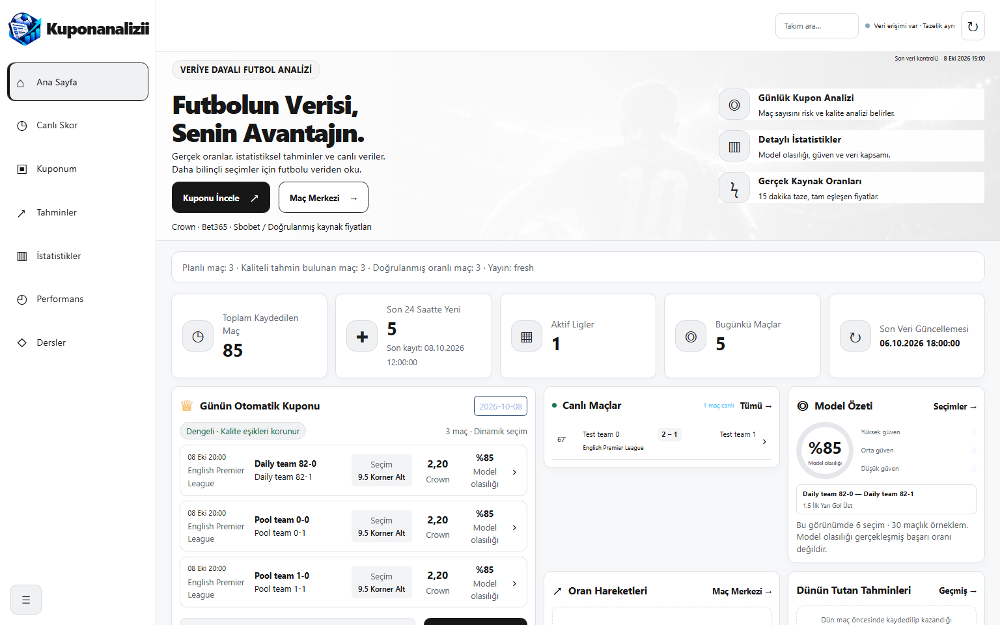
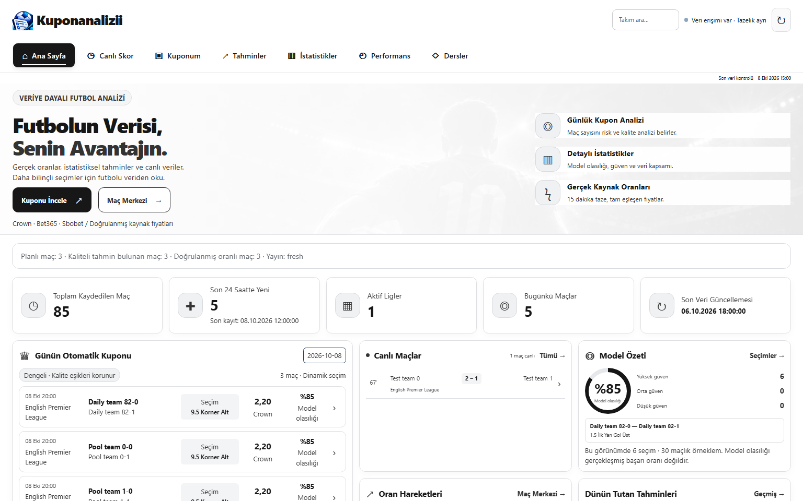

# Kuponanalizii: horizontal navigation and monochrome refresh

This change affects only dashboard HTML, the existing presentation stylesheet, navigation/search UI code, tests and this evidence. It is based on master `12e1f10d9731db699cc99286bb137dce234e1f72` (including #136–#139).

The logo and search/connection tools share the first header row. One seven-link navigation occupies the second row at all widths; phones scroll that row horizontally. Sidebar markup, collapse persistence and the duplicate bottom navigation are removed. Active links have `aria-current=page`, a black background, white text and an underline. Hover raises the link with a shadow and animates its underline over 300 ms. Page sections enter from above over 300 ms without reloading the document. Reduced-motion visitors get immediate state changes with no entrance or hover movement.

Tab/Shift+Tab and Enter use native link behavior; Left/Right/Home/End provide optional focus shortcuts. A route change focuses its page heading and resets the content scroll. Back/forward and existing match deep links retain the current router. The mobile search closes with Escape or page navigation. Scrollable table regions can receive keyboard focus.

White and pale-gray surfaces, dark copy, black primary actions, light-gray table rules and nested-panel overrides replace the remaining navy paints and pale captions. The home board uses the released sidebar width, with a larger coupon column and aligned live/model/movement cards. Existing match, prediction and performance tables scroll inside their regions rather than widening the viewport. The model probability ring reads the existing `--probability` display variable.

## Browser evidence

All captures use Chromium at 100% scale, widths **390** and **1536**, and a height of **960**. These are explicitly **synthetic isolated SQLite/ASGI fixtures**, not production records or evidence of live profitability. The same fixtures include a published daily coupon, recorded settled predictions, a live match and a saved learning edition. The baseline serves HTML, CSS and JS from commit `12e1f10`; the after captures serve this branch. Screenshot captures open disclosure sections so hidden table/detail surfaces are also checked.

Automated assertions cover all seven links at both widths and both motion preferences, one visible page, active state, no document reload, no viewport overflow, keyboard shortcuts, focus outline, browser back/forward, mobile search dismissal, actual intermediate animation opacity/translation and hover underline/shadow. The match analysis dialog is also checked at both widths across all 11 tabs, including its recorded statistics/odds/form content. [Desktop dialog](screenshots/after-dialog-1536.png) · [Mobile dialog](screenshots/after-dialog-390.png). Each page's visible HTML surfaces are scanned for navy backgrounds and its small text is checked for at least 4.5:1 contrast against its opaque ancestor surface. This is targeted browser regression coverage, not a claim of a complete accessibility audit. Main legacy UI integration tests retain their existing API, coupon, bookmaker, prediction and learning assertions and now target the single upper navigation.

Reproduce the after checks/captures in PowerShell:

```powershell
$env:NAV_SCREENSHOT_DIR='docs/top-navigation/screenshots'
python -m pytest -q tests/test_top_navigation.py
```

For matching baseline captures, additionally set `$env:NAV_CAPTURE_PHASE='before'`. Remove that variable for acceptance testing. Baseline mode skips new-navigation assertions and is only for screenshot comparison; CI runs the normal after checks.

## Before / after

### 1536 px

| Page | Before | After |
|---|---|---|
| Ana Sayfa | [Before](screenshots/before-home-1536.png) | [After](screenshots/after-home-1536.png) |
| Canlı Skor | [Before](screenshots/before-matches-1536.png) | [After](screenshots/after-matches-1536.png) |
| Kuponum | [Before](screenshots/before-coupon-1536.png) | [After](screenshots/after-coupon-1536.png) |
| Tahminler | [Before](screenshots/before-predictions-1536.png) | [After](screenshots/after-predictions-1536.png) |
| İstatistikler | [Before](screenshots/before-markets-1536.png) | [After](screenshots/after-markets-1536.png) |
| Performans | [Before](screenshots/before-performance-1536.png) | [After](screenshots/after-performance-1536.png) |
| Dersler | [Before](screenshots/before-lessons-1536.png) | [After](screenshots/after-lessons-1536.png) |

### 390 px

| Page | Before | After |
|---|---|---|
| Ana Sayfa | [Before](screenshots/before-home-390.png) | [After](screenshots/after-home-390.png) |
| Canlı Skor | [Before](screenshots/before-matches-390.png) | [After](screenshots/after-matches-390.png) |
| Kuponum | [Before](screenshots/before-coupon-390.png) | [After](screenshots/after-coupon-390.png) |
| Tahminler | [Before](screenshots/before-predictions-390.png) | [After](screenshots/after-predictions-390.png) |
| İstatistikler | [Before](screenshots/before-markets-390.png) | [After](screenshots/after-markets-390.png) |
| Performans | [Before](screenshots/before-performance-390.png) | [After](screenshots/after-performance-390.png) |
| Dersler | [Before](screenshots/before-lessons-390.png) | [After](screenshots/after-lessons-390.png) |

### Home comparison, desktop

Before:



After:



The remaining screenshots, hover crops, transition midpoints and per-page assertion summaries are in [screenshots](screenshots).

## Operational scope

No server routes, DB schema/data, Goaloo collection, Crown/Bet365/Sbobet odds, model calculations, daily coupon rules, settlement worker, Telegram configuration, NVIDIA flag, hybrid-history flag or Render configuration are changed. Browser HTTP is intercepted and served by isolated ASGI test fixtures; no real Telegram or NVIDIA request is made. No merge or Render deployment is part of this change.
